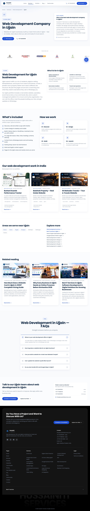
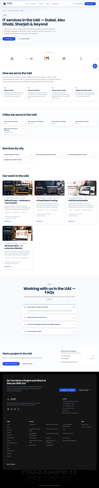
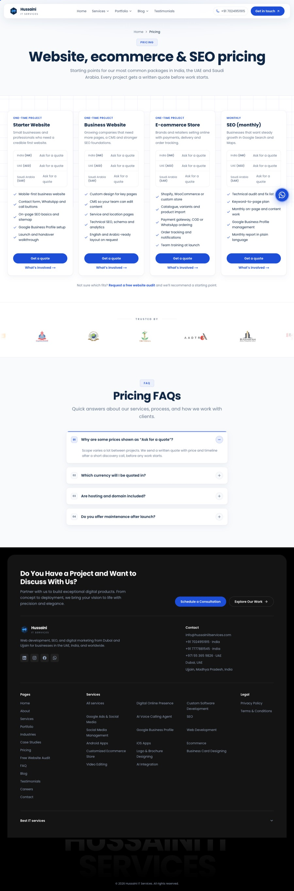
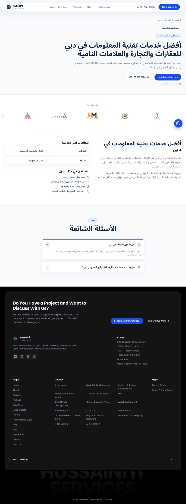

# SEO expansion — review handbook

Everything you need to review before launch. Commits are split per task (Task 1–10).

## New URLs

### Service + city pages (16) — `src/lib/seo/service-locations.ts`
- `/services/web-development/ujjain`
- `/services/web-development/indore`
- `/services/web-development/bhopal`
- `/services/web-development/dubai`
- `/services/web-development/riyadh`
- `/services/web-development/jeddah`
- `/services/seo/ujjain`
- `/services/seo/indore`
- `/services/seo/dubai`
- `/services/seo/riyadh`
- `/services/ecommerce/dubai`
- `/services/ecommerce/riyadh`
- `/services/ecommerce/indore`
- `/services/google-business-profile/ujjain`
- `/services/google-business-profile/indore`
- `/services/google-business-profile/dubai`

### New city pages (13) — `src/lib/seo/locations.ts`
- `/best-it-services/bhopal`
- `/best-it-services/jabalpur`
- `/best-it-services/gwalior`
- `/best-it-services/sagar`
- `/best-it-services/jeddah`
- `/best-it-services/dammam`
- `/best-it-services/al-khobar`
- `/best-it-services/makkah`
- `/best-it-services/madinah`
- `/best-it-services/ajman`
- `/best-it-services/ras-al-khaimah`
- `/best-it-services/muscat`
- `/best-it-services/manama`

### Country / region hubs — `src/lib/seo/markets.ts`
- `/it-services`
- `/it-services/india`
- `/it-services/uae`
- `/it-services/saudi-arabia`
- `/it-services/gcc`

### Industries — `src/lib/seo/industries.ts`
- `/industries`
- `/industries/real-estate`
- `/industries/jewellery`
- `/industries/fashion-ecommerce`
- `/industries/travel-tourism`
- `/industries/industrial-manufacturing`

### Trust & conversion
- `/pricing`
- `/faq`
- `/free-website-audit`
- `/case-studies`

### Localized pages — `src/i18n/` (live: indexed, hreflang, sitemap)
- Arabic (RTL): `/ar`, `/ar/services`, `/ar/it-services/{uae,saudi-arabia,gcc}`, and `/ar/best-it-services/{dubai,abu-dhabi,sharjah,ajman,ras-al-khaimah,riyadh,jeddah,dammam,al-khobar,makkah,madinah,kuwait,doha,muscat,manama}`
- Hindi: `/hi`, `/hi/services`, `/hi/it-services/india`, and `/hi/best-it-services/{ujjain,indore,dewas,ratlam,mandsaur,nagda,shajapur,bhopal,jabalpur,gwalior,sagar}`
- Header, menus, offer banner and footer are translated; `<html lang/dir>` is set per locale.

### Generated images
`opengraph-image` + `twitter-image` for every service, service+city, city, hub, industry and blog URL.

No existing URL was renamed or removed, so no redirects were needed.

## TODO placeholders for you

### Pricing — `src/lib/seo/pricing.ts`
Quote-only by design: no prices are published. Each package shows "Custom quote" (INR · AED · SAR).
- [ ] Confirm what each package includes.

### Contact — `src/lib/seo/offices.ts`
- [ ] Is +971 55 365 9826 on WhatsApp? UAE/GCC pages currently use the India WhatsApp number (the only one on the site).
- [ ] Street address + postcode for Ujjain and Dubai offices (LocalBusiness schema currently has city/country only).

### Content review (all drafts, written only from facts on the site)
- [ ] 16 service+city pages — `service-locations.ts` (set `reviewStatus: "approved"` per entry)
- [ ] 13 new city pages — `locations.ts` (block marked `TODO(content-review)`)
- [ ] 4 hubs — `markets.ts`
- [ ] 5 industries — `industries.ts`
- [ ] "Working with us" FAQs — `faqs.ts`
- [ ] Free audit scope/turnaround — `app/free-website-audit/page.tsx`
- [ ] Portfolio tags — `portfolio-tags.ts` (add new portfolio slugs here so they appear on city/industry pages)

### Translations — `src/i18n/dictionaries/`
- [ ] Native-speaker review of the Arabic and Hindi copy. It is machine-translated and already live;
  `humanReviewed: false` in `ar.ts` / `hi.ts` keeps a review banner visible in development only.
  Set it to `true` after review.
- To take a single page offline while editing, set its `status` to `"draft"` (noindex, removed from hreflang and sitemap).

### Blog titles to shorten in /admin (> 60 characters)
- google-ai-overviews-ai-mode-seo-uae-india-2026
- importance-of-google-business-profile-for-local-businesses
- website-development-cost-in-ujjain
- every-business-in-ujjain-needs-online-presence-before-simhastha-2028
- professional-website-benefits-small-businesses

### Database
- [ ] Run `supabase/queries/16-add-portfolio-updated-at.sql` so portfolio lastmod uses real edit dates (the app works without it).

## Re-running the checks
```bash
npm run build && npx next start -p 3200
node scripts/seo-audit.mjs http://localhost:3200   # every sitemap URL: title/desc, canonical, H1, OG, JSON-LD
```

## Screenshots
| Service + city (desktop) | Service + city (mobile) |
|---|---|
|  |  |

| UAE hub | Pricing | Arabic (RTL) city page |
|---|---|---|
|  |  |  |
